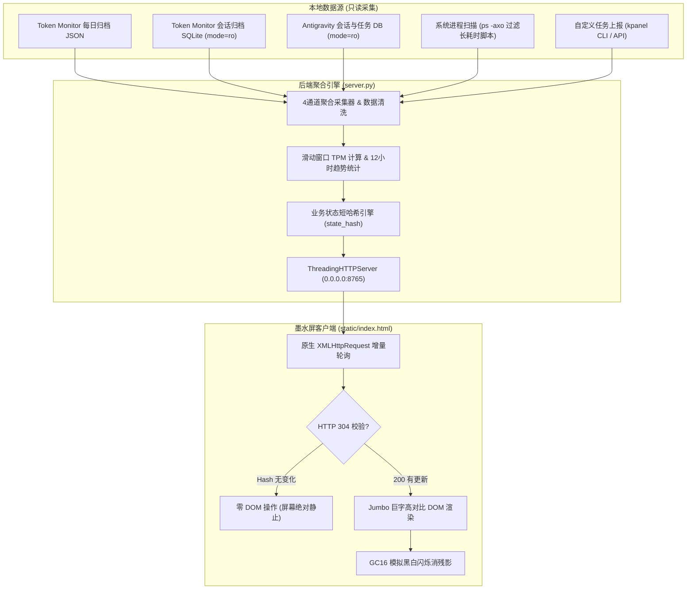

<div align="center">

# 📟 Kindle Token & Task Monitor Panel

**将闲置 Kindle（未越狱）改造成桌面极客专用的高对比度实时 AI Token 与多智能体在途任务监控墨水屏**

[](LICENSE)
[](https://www.python.org/)
[](#-kindle-全机型硬件适配)
[-success.svg)](#-核心特性)

*Turn any idle Kindle (including Kindle X Migu) into an ambient, zero-dependency, e-ink dashboard for real-time LLM token usage and autonomous agent task progress.*

</div>

---

## 🌟 核心特性 (Features)

- 🔒 **免越狱与绝对安全只读**：无需对 Kindle 进行越狱或刷机，使用系统原生浏览器即可运行；外部 SQLite 均以 `file:...mode=ro` 只读模式连接，零侵入、绝不写脏数据。
- ⚡ **零第三方依赖**：纯 Python 3 标准库实现（`http.server`, `sqlite3`, `subprocess`, `struct`），无需 `pip install` 任何库，开箱即跑。
- 🕶️ **墨水屏专属 HTTP 304 零重绘机制**：对核心业务指标计算特征短哈希 `state_hash`，数据无变化时服务端响应 `304 Not Modified`，前端零 DOM 变动，**屏幕彻底不闪烁**。
- 🔍 **桌面巨字高对比版 (Jumbo Desk Edition)**：
  - 强制锁定 `600px` 物理视口并自动检测宽视口比例补偿，破除老款 Android WebKit 默认按 980px 缩小的问题；
  - 默认基准字号 **`28px`**（核心数字 **`53px`** 超粗黑体 + `0.3px` 墨水屏笔画加黑）；
  - 提供 `[字-]` 和 `[字+]` 按钮（**16px~72px** 无级调节并本地持久化），远距离摆在桌面上也能一目了然。
- 📊 **四通道全量在途任务并列监控**：
  1. **Antigravity 会话池**：实时解析执行状态与 `task.md` 真实打勾步数（如 `4/7`）；
  2. **Token Monitor 外部客户端**：实时捕获 Claude, Codex, Devin, OpenCode 活跃会话；
  3. **本地长耗时脚本扫描**：智能识别后台爬虫、Remotion 渲染进程并过滤 Chrome 子进程；
  4. **自定义任务上报池**：任意 Python / Shell 脚本一行 CLI 命令实时推送进度。
- ⚠️ **审批等待态纯黑反色高亮**：任务处于 `APPROVAL`（等待人类干预/确认）时，对应任务整卡瞬间反转为**纯黑底白字**醒目提醒。
- 🧹 **GC16 软全刷防残影 + 2小时内存防泄漏**：每 20 次有效更新或手动点击 `[消残影]` 翻转黑白遮罩复位墨水微胶囊；内置定时器每 2 小时刷新 WebKit 堆内存。
- 🚀 **Kindle X 咪咕版隐藏浏览器一键唤醒**：内置专用电子书生成器，通过 MTP 自动推送带超链接的 `.mobi` / `.pdf` 跳板书，一键打开官方隐藏的体验版浏览器！

---

## 🖥️ 墨水屏视觉示意图 (ASCII Dashboard)

```text
┌────────────────────────────────────────────────────────┐
│ KINDLE MONITOR  [LIVE]                        23:18:42 │
├────────────────────────────────────────────────────────┤
│ [今日/7日]  [字-] [字+]  [横/竖]             [消残影] │
├────────────────────────────────────────────────────────┤
│ ┌──────────────────────────┬─────────────────────────┐ │
│ │         39.17M           │          $6.23          │ │
│ │       今日 TOKENS        │        预估费用         │ │
│ ├──────────────────────────┴─────────────────────────┤ │
│ │ In: 7.19M                │ Out: 579K               │ │
│ │ Cache: 31.24M            │ TPM: 28,460             │ │
│ └────────────────────────────────────────────────────┘ │
├────────────────────────────────────────────────────────┤
│ 在途任务池 (3)                             [◀] 1/2 [▶] │
│ ┌────────────────────────────────────────────────────┐ │
│ │ [AGY·主控] Kindle Task Dashboard Planning    08:34 │ │
│ │ [■■■■■■■■□□□□] 4/7 (64%)                           │ │
│ │ Step 118 · Executing subagent implementation plan  │ │
│ ├────────────────────────────────────────────────────┤ │
│ │ [⚠️ 待审批] 生产环境数据库迁移确认            02:15 │ │
│ │ [■■■■■■■■■■■□] 92% (11/12)                         │ │
│ │ Waiting for manual approval before applying schema │ │
│ └────────────────────────────────────────────────────┘ │
├────────────────────────────────────────────────────────┤
│ 模型消耗榜 TOP 5 (MODELS)                              │
│ • swe-2-max              27.23M               $0.00    │
│ • gemini-3.8-flash        7.61M               $1.86    │
│ • gemini-4-argon          3.38M               $1.46    │
│ • claude-opus-5.5 ⚡       838.9K               $2.91    │
└────────────────────────────────────────────────────────┘
```

---

## 🏗️ 系统架构与数据流 (Architecture)



---

## ⚡ 3 步快速开始 (Quickstart)

### 步骤 1：克隆仓库并启动后台服务

你可以选择直接启动或一键配置为 macOS 开机自启服务：

```bash
git clone https://github.com/STARKTANG108/kindle-token-panel.git
cd kindle-token-panel

# 方式 A：一键安装为 macOS 开机自启常驻服务 (推荐)
./install_launchd.sh

# 方式 B：直接前台运行
python3 server.py
```

控制台将输出服务地址（包含局域网 IP，如 `http://192.168.1.x:8765`）。

### 步骤 2：在 Kindle 上打开监控面板

#### 📱 普通国际版 Kindle (Paperwhite / Oasis / Voyage / Scribe)
1. 确保 Kindle 与电脑连接在**同一 Wi-Fi 局域网**；
2. 打开 Kindle 顶部菜单 -> **体验版浏览器 (Experimental Browser)**；
3. 输入终端打印的局域网地址（如 `http://192.168.1.x:8765`）；
4. 进入面板后，点击浏览器右上角菜单，将页面**添加为书签**。

#### 📖 Kindle X 咪咕版 (`KFBJWI` 官方隐藏浏览器专属方案)
咪咕版系统隐藏了浏览器图标，需通过**带超链接的电子书跳板**唤醒：
1. 用 USB 数据线将 Kindle 接入电脑；
2. 运行内置生成脚本（自动探测本机 IP 并通过 MTP 推送）：
   ```bash
   # 如果系统装有 libmtp，一键注入书库
   python3 make_launcher_books.py --push-mtp
   
   # 或者手动生成后拷入 Kindle 的 documents/ 目录
   python3 make_launcher_books.py
   ```
3. 打开 Kindle 书架上的 **《⚡ Token 实时任务面板》**；
4. 点击书中的大按钮 **`[👉 点击此处一键打开实时监控面板 👈]`**，隐藏的 WebKit 浏览器将立即唤醒并进入面板！

### 步骤 3：开启屏幕防休眠常亮 (Keep-Awake)

插上 USB 供电线，让 Kindle 永不黑屏：
1. 在 Kindle 顶栏搜索框中输入：
   ```text
   ~ds
   ```
   *(注：部分机型需先输入 `;debugOn` 回车，再输入 `~ds` 回车)*；
2. 屏幕休眠已完全关闭，现在它就是一块极客感拉满的桌面永亮墨水屏！
   *(如需恢复正常休眠，重启 Kindle 即可)*。

---

## ⌨️ `kpanel` 命令行工具使用 (CLI Companion)

`kpanel` 是一个纯 Python 标准库编写的可执行 CLI 工具，方便将任何脚本、爬虫、训练流水线的进度实时同步到 Kindle 屏幕上。

```bash
# 1. 推进任务进度（自动换算 12 格墨水屏进度条）
./kpanel push "数据挖掘流水线" --step 3 --total 10 --detail "正在抓取第3批次" --source "Pipeline"

# 2. 触发审批等待态（Kindle 屏幕上整张卡片瞬间反色为纯黑底白字！）
./kpanel push "生产部署确认" --detail "等待人工确认操作" --approval

# 3. 标记任务完成（从屏幕上自动移除）
./kpanel done "数据挖掘流水线"

# 4. 终端随时查看仪表盘当前状态
./kpanel status
```

---

## 🔌 HTTP REST API

服务提供轻量级标准 HTTP 接口：

| 方法 | 路径 | 说明 |
| :--- | :--- | :--- |
| `GET` | `/` | 返回高对比度 ES5 墨水屏前端页面 |
| `GET` | `/api/state?hash=<last_hash>` | 查询当前状态；若传入的 `hash` 与当前 `state_hash` 一致，直接返回 `304 Not Modified` |
| `POST` | `/api/task` | 写入或更新自定义任务（JSON: `title`, `step`, `total`, `pct`, `status`, `detail`, `source`） |
| `DELETE` | `/api/task?id=...` | 删除指定任务 |

---

## 🤖 作为 Agent Skill 安装与调用

本项目符合标准 Agent Skill 规范，可以直接作为技能安装至 Claude Code、Antigravity 或其他智能体框架：

```bash
# 克隆到项目的 .agents/skills 目录下即可被智能体自动识别激活
mkdir -p .agents/skills
git clone https://github.com/STARKTANG108/kindle-token-panel.git .agents/skills/kindle-token-panel
```

智能体读取 `SKILL.md` 后，即可完全自主执行：探测本地数据源 -> 启动开机常驻服务 -> 检测 USB 连接 Kindle 型号 -> 制作并注入跳转电子书 -> 通过 `kpanel` 推送多 Agent 协同状态。

---

## 📄 开源许可证 (License)

本项目基于 [MIT License](LICENSE) 开源发布。
欢迎 Star ⭐️ 与 PR 改进！
